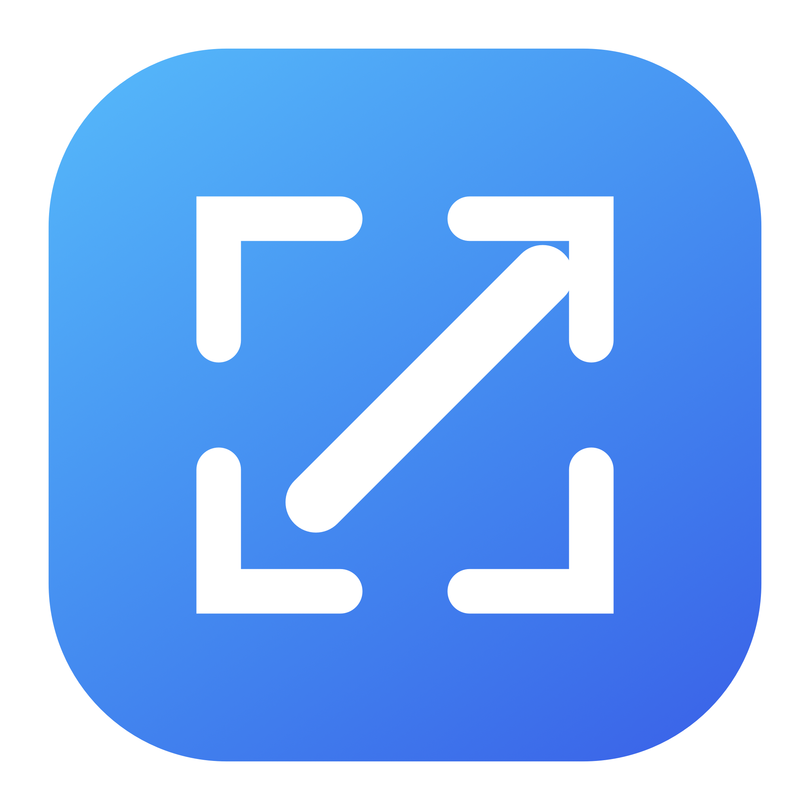

# SnapMark



SnapMark is a free, open-source, native macOS screenshot utility. Select a
region across one or more displays, annotate it, and copy it directly to the
clipboard. It runs entirely on your Mac: no account, analytics, uploads, or
cloud service.

## Features

- Rectangular region capture on one or multiple displays
- Pen, rectangle, ellipse, and arrow annotations
- Color selection and undo
- Copy annotated results directly to the clipboard
- Save the display under the mouse pointer directly to Desktop
- Menu-bar operation with global shortcuts
- Mixed Retina and non-Retina display support
- No network access and no automatic screenshot storage

## Safety controls

Capture mode always provides several independent ways out:

- Press `Esc`
- Press `⌘.`
- Right-click anywhere
- Click **Cancel · Esc** on any display
- Open the menu-bar icon and choose **Quit SnapMark**
- Press `⌘Q`
- Wait 60 seconds for the automatic safety timeout

Starting a new capture also cancels any existing capture overlay first. The
overlay stays below the macOS menu bar so system controls remain reachable.

## Requirements

- Apple-silicon Mac
- macOS 14 Sonoma or later
- Screen Recording permission, used only to read the pixels you select

## Install

### Option 1: Download a release

Download `SnapMark-arm64.zip` from the
[latest release](https://github.com/ftkurt/SnapMark/releases/latest), unzip it,
and drag `SnapMark.app` to `/Applications`.

Because this free build is not notarized with a paid Apple Developer
certificate, macOS may block its first launch. Right-click the app and choose
**Open**, or approve it under **System Settings → Privacy & Security**. Never
disable Gatekeeper globally.

### Option 2: Install the latest release from Terminal

Install for your user without administrator access:

```sh
curl -fsSL https://raw.githubusercontent.com/ftkurt/SnapMark/main/install.sh | zsh
```

This installs to `~/Applications/SnapMark.app`.

Install system-wide:

```sh
curl -fsSL https://raw.githubusercontent.com/ftkurt/SnapMark/main/install.sh | zsh -s -- --system
```

### Option 3: Build from source

Xcode Command Line Tools and Swift are required.

```sh
git clone https://github.com/ftkurt/SnapMark.git
cd SnapMark
./install.sh --source
```

Use `./install.sh --source --system` to install to `/Applications`.

## Usage

| Action | Menu item | Shortcut |
|---|---|---|
| Capture and annotate a region | Capture Region | `⌘⇧2` |
| Save the display under the pointer | Save Current Screen to Desktop | `⌘⇧1` |
| Exit | Quit SnapMark | `⌘Q` while active |

For a region capture, drag a rectangle, annotate it, and click
**Copy & Close** or press Return. The result is placed on the clipboard.

## Permissions and privacy

SnapMark needs macOS Screen Recording permission. It does not record video or
audio. Region captures remain in memory; only **Save Current Screen to
Desktop** writes a file. See [PRIVACY.md](PRIVACY.md) for the full policy.

If macOS repeatedly asks for permission after rebuilding, install the app from
one stable path. SnapMark embeds a stable local designated requirement so
permission survives ordinary local rebuilds.

See [Troubleshooting](docs/TROUBLESHOOTING.md) for permission recovery and
emergency overlay-removal instructions.

## Build a distributable ZIP

```sh
./scripts/package-release.sh
```

Artifacts are written to `release/` with a SHA-256 checksum.

## Contributing

Bug reports and pull requests are welcome. Read
[CONTRIBUTING.md](CONTRIBUTING.md) before submitting changes.

## License

SnapMark is available under the [MIT License](LICENSE).
